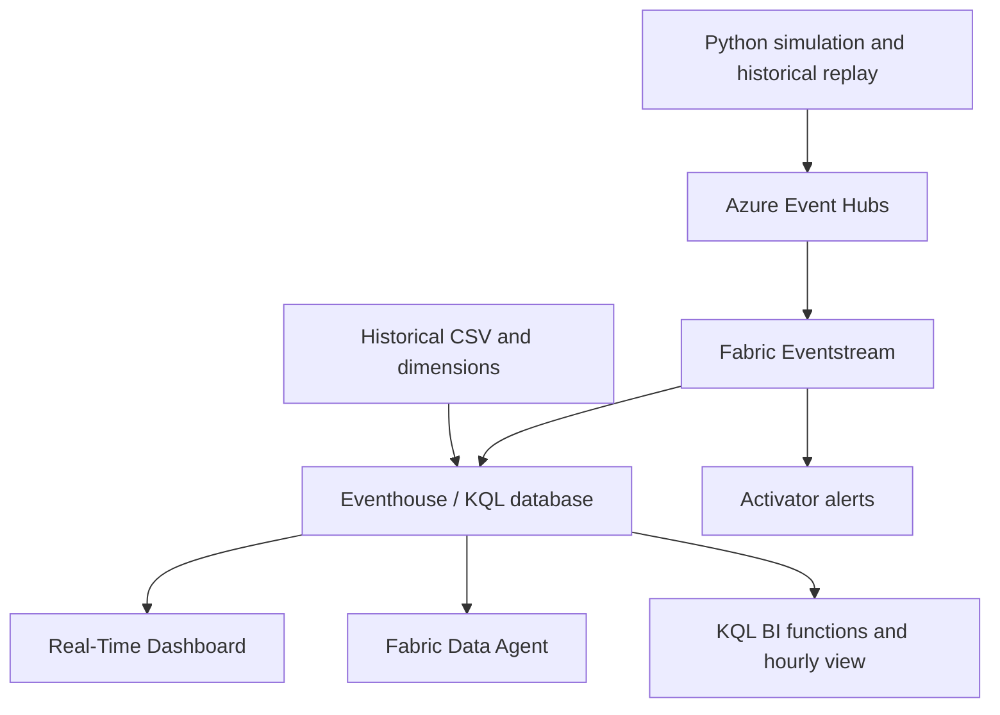

# Real-Time Manufacturing Analytics Dashboard

Manufacturing telemetry analytics on Microsoft Fabric: monitor asset health, investigate quality risk across sites and products, and detect abnormal operating conditions in real time.

The platform combines historical and streaming sensor data in an Eventhouse, serves KQL-powered operational dashboards, routes threshold alerts through Activator, and supports natural-language exploration through a Fabric Data Agent. Python simulators exercise normal and anomalous conditions without requiring factory hardware.

## Capabilities

- **Live operational monitoring:** asset temperature, vibration, humidity, speed, and modeled defect risk, with site and product context.
- **Interactive simulation:** per-asset normal/anomaly controls, statistics, configurable intervals, and graceful shutdown.
- **Historical analysis:** sample dimensions and 90-day event generation, ingestion utilities, and deployable Fabric dashboard definitions.
- **Alerting and investigation:** Activator definitions, configurable notification recipient, and a Fabric Data Agent with manufacturing-specific instructions and example queries.
- **Scale workload tooling:** configurable event count, including a 50M-event profile; bounded CSV shards; deterministic event IDs; manifest checksums; full preflight validation; and durable batch-level replay checkpoints.
- **BI semantics:** deduplicated event-window queries, hourly site risk, modeled cost exposure, missing-dimension counts, arrival-weighted materialized aggregates, and ingestion-delay monitoring. A separate enhanced dashboard adds four tiles while retaining both existing pages.
- **Engineering validation:** offline regression and recovery tests, GitHub Actions, isolated-tenant checks, a live-pipeline probe, reproducible local generation measurements, and a raw-versus-aggregate KQL benchmark runner.

## Architecture



The implementation retains synchronous Python services, per-asset simulator threads, declarative Fabric JSON definitions, Bicep infrastructure, and Azure Developer CLI lifecycle hooks. There is no separate web server or frontend state store. See [architecture](docs/TechnicalArchitecture.md) and [data contracts](docs/DataContracts.md).

## Technology stack

| Layer | Technologies |
|---|---|
| Runtime and generation | Python 3.11+, pandas, Python standard library |
| Messaging and authentication | Azure Event Hubs SDK, Azure Identity, Azure Core |
| Analytics | Microsoft Fabric Eventstream, Eventhouse, KQL, Real-Time Dashboard |
| Alerts and conversational access | Fabric Activator, Fabric Data Agent, configuration notebook |
| Provisioning and integration | Bicep, Azure Developer CLI, Azure CLI, PowerShell, requests |
| Fabric data operations | Azure Kusto Data/Ingest, Azure Data Lake Storage SDK, Azure Event Hub management SDK, python-dateutil |
| Validation | unittest, GitHub Actions |

The existing dependency families remain in [requirements.txt](requirements.txt). Added modules require no new third-party libraries.

## Local quick start

From the repository root, Python 3.11 or 3.12:

```bash
python -m venv .venv
source .venv/bin/activate
python -m pip install -r requirements.txt
PYTHONPATH=src python -m unittest discover -s tests -v
python src/scale_data.py --events 10000 --rows-per-file 5000 --output workload/smoke
python src/validate_workload.py workload/smoke
```

On Windows, activate with `.venv\Scripts\Activate.ps1`; set `$env:PYTHONPATH="src"` before running `python -m unittest discover -s tests -v`.

The smoke generator, validator, and tests use only the Python standard library and run without Azure credentials. Cloud operations require the packages in requirements.txt and an authenticated Azure/Fabric environment.

## Deploy

Follow [deployment instructions](docs/DeploymentGuide.md) for tenant permissions, tooling, configuration, provision/deprovision steps, and analytics setup. `azd up` provisions paid Azure resources and Fabric items; local tests do not deploy them.

After deployment, start the live simulator:

```bash
python src/simulator/event_simulator.py --interval 2 --max-runtime 300
```

Use `anomaly 1`, `normal 1`, `status`, and `stats` in the simulator console. Existing operational guides cover [dashboard usage](docs/RealTimeIntelligenceDashboardGuide.md), [alerts](docs/ActivatorGuide.md), [data ingestion](docs/FabricDataIngestion.md), and [the data agent](docs/FabricDataAgentGuide.md).

## Scale and performance

```bash
python src/scale_data.py --events 50000000 --rows-per-file 100000 --output workload/50m
python src/validate_workload.py workload/50m
python src/replay_workload.py workload/50m
```

The 50M profile is a configurable workload, not a claim of a completed 50M cloud run. Replay preserves event IDs, uses SDK byte-limited batches, and resumes from durable checkpoints by default in the CLI. It sends through the same Event Hubs and Fabric path as live simulation.

A local run generated **100,000 events in 5.49 seconds**, writing **12.66 MB** of CSV across 10 shards with **13.56 MiB process peak RSS**. These are local synthetic generation measurements, not ingestion throughput or dashboard latency. Hardware and method are recorded in [performance documentation](docs/Performance.md) and [raw measurements](docs/benchmarks/local-generation.json).

## Repository layout

```text
src/
  entities/             Manufacturing asset and event models
  simulator/            Interactive simulation and Event Hub service
  definitions/          Fabric dashboard, Eventstream, Activator, environment
  data_agent/           Agent instructions and example queries
  notebooks/            Fabric data-agent configuration
  analytics/            Event contracts and additive KQL definitions
  scale_data.py         Sharded historical workload generation
  validate_workload.py   Manifest and contract verification
  replay_workload.py     Checkpointed Event Hub replay
  audit_workload.py      Invalid-row quarantine reporting
infra/
  main.bicep            Azure infrastructure
  modules/              Cross-scope Event Hub deployment
  scripts/fabric/       Fabric provisioning and analytics deployment
  scripts/benchmarks/   Local and cloud benchmark runners
  scripts/utils/        PowerShell deployment helpers
  data/                 Sample dimensions and historical events
  vscode_web/           Azure web development integration
docs/                  Operating documentation
tests/                 Offline regression tests
```


## BI extensions and operational checks

```bash
python infra/scripts/fabric/build_analytics_assets.py
python infra/scripts/fabric/deploy_bi_extensions.py --help
python infra/scripts/fabric/validate_tenant.py --help
python infra/scripts/fabric/probe_pipeline.py --help
python infra/scripts/benchmarks/capture_environment.py --output benchmark-output/environment.json
```

The extension deployer applies KQL before deploying the enhanced dashboard. Use the existing dashboard title to retain the original pages and add the new quality-risk/health page. See [deployment](docs/DeploymentGuide.md) for required tenant identifiers and acceptance checks.

## Engineering scope

[Changes and tradeoffs](docs/EngineeringChanges.md) explain enhancements and compatibility. [Operations](docs/Operations.md) covers duplicate delivery, partial replay, monitoring, retention, recovery, and rollout checks. Cloud deployment, KQL execution, permissions, and production SLOs must be verified using the provided tenant checks; offline tests do not certify them. Fabric Data Agent availability depends on tenant configuration and supported features.

MIT licensed. See [LICENSE](LICENSE) and [NOTICE](NOTICE) for retained third-party notices.
